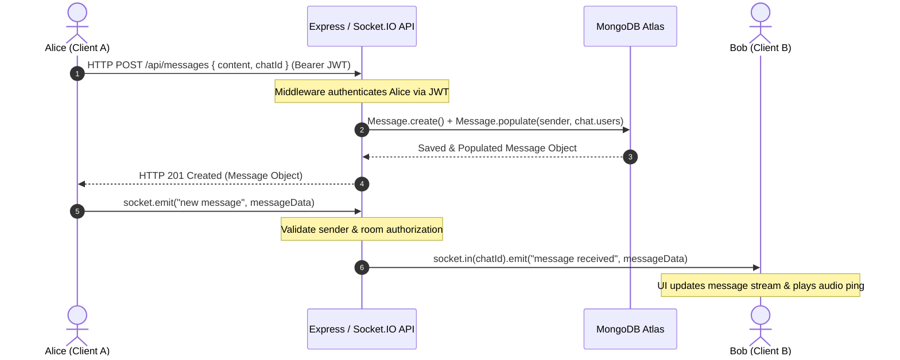
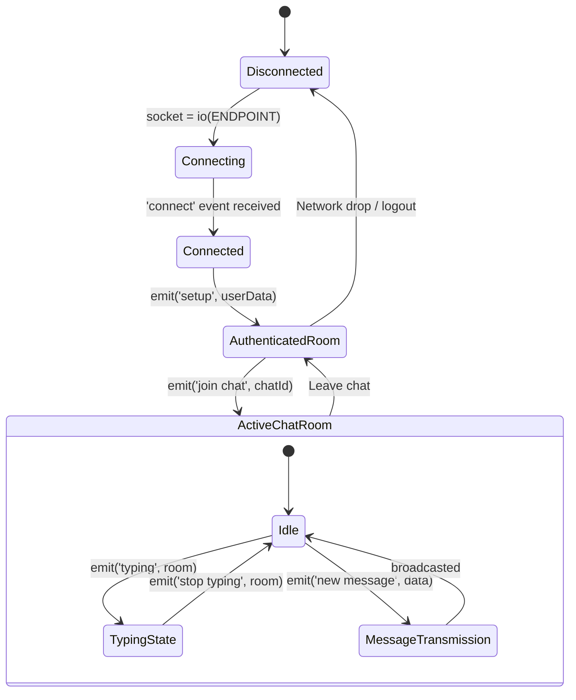

<div align="center">

# 🔐 MSG_CRYPT — Enterprise Encrypted Chat & Real-Time Terminal

**Production-grade, end-to-end encrypted messaging engine with a cyberpunk CRT-terminal aesthetic.**

[](https://nodejs.org/)
[](https://react.dev/)
[](https://www.mongodb.com/atlas)
[](https://socket.io/)
[](https://expressjs.com/)
[](https://vitejs.dev/)
[](https://tailwindcss.com/)
[](https://render.com/)
[](LICENSE)

<br/>

### 🌐 Live Production Deployments

| Service | Environment | Live URL | Health Status |
|:---|:---|:---|:---|
| **Frontend Application** | Production (Render Static) | [https://encriptedtalks.vercel.app](https://encriptedtalks.vercel.app) | `ONLINE` |
| **Backend REST & WebSocket API** | Production (Render Web Service) | [https://encrypted-chat-web.onrender.com](https://encrypted-chat-web.onrender.com) | `ONLINE` |

<br/>

### 👨‍💻 Created by **Pawan Kumar**

[](https://pawankumar.info/)
[](https://www.linkedin.com/in/pawankumar101/)
[](https://leetcode.com/u/pk3253702/)
[](https://github.com/POWER-WORLD)

<br/>

*An enterprise-ready, full-stack MERN real-time communication platform engineered with high-throughput WebSocket concurrency, rate-limited and secured REST APIs, JWT authentication, group conversation topology, typing telemetry, and a nostalgic hacker-terminal visual interface.*

</div>

---

## 📑 Table of Contents

- [Application Interface & Visual Showcase](#-application-interface--visual-showcase)
- [Architectural Overview](#-architectural-overview)
  - [System Topology](#system-topology)
  - [Message Delivery Flow](#message-delivery-flow)
- [Key Features](#-key-features)
- [Repository Structure](#-repository-structure)
- [Tech Stack & Dependencies](#-tech-stack--dependencies)
- [System Requirements & Prerequisites](#-system-requirements--prerequisites)
- [Local Development Setup](#-local-development-setup)
- [Environment Configuration](#-environment-configuration)
- [Production Deployment on Render](#-production-deployment-on-render)
  - [Option A: Infrastructure-as-Code (Blueprint)](#option-a-infrastructure-as-code-blueprint)
  - [Option B: Manual Dashboard Setup](#option-b-manual-dashboard-setup)
- [Comprehensive REST API Reference](#-comprehensive-rest-api-reference)
  - [Health Check](#health-check)
  - [Authentication Endpoints (`/api/users`)](#authentication-endpoints-apiusers)
  - [Chat Management Endpoints (`/api/chats`)](#chat-management-endpoints-apichats)
  - [Message Endpoints (`/api/messages`)](#message-endpoints-apimessages)
- [Socket.IO Real-Time Protocol Specification](#-socketio-real-time-protocol-specification)
- [Data Models & Schema Architecture](#-data-models--schema-architecture)
- [Security Hardening & Best Practices](#-security-hardening--best-practices)
- [Frontend Architecture & UI Systems](#-frontend-architecture--ui-systems)
- [Testing & Quality Assurance](#-testing--quality-assurance)
- [Troubleshooting & FAQ](#-troubleshooting--faq)
- [Contributing Guidelines](#-contributing-guidelines)
- [Author & Acknowledgments](#-author--acknowledgments)
- [License](#-license)

---

## 📸 Application Interface & Visual Showcase

<div align="center">

### 💬 Real-Time Encrypted Chat Terminal & Active Uplinks
*Full-stack live communications hub displaying authenticated operator session, active peer nodes, encrypted transmission streams, and group channels.*

<br/>

<a href="frontend2/public/screenshots/Screenshot%202026-11-21%20200217.png" target="_blank">
  
</a>

<br/><br/>

### 🛡️ Operator Authentication Terminal
*Cyberpunk access gateway with glowing interactive credentials verification, brute-force rate-limiting, and architect telemetry links.*

<br/>

<a href="frontend2/public/screenshots/Screenshot%202026-11-21%20200244.png" target="_blank">
  
</a>

<br/><br/>

### ⚡ Node Registration & Identity Provisioning Terminal
*Identity initialization terminal featuring real-time handle checks, email validation, password security criteria, and integrated avatar asset uploads.*

<br/>

<a href="frontend2/public/screenshots/Screenshot%202026-11-21%20200257.png" target="_blank">
  
</a>

<br/>

</div>

---

## 🏗 Architectural Overview

MSG_CRYPT is architected as an asynchronous, decoupled client-server system separating stateless REST operations from stateful WebSocket streams.

### System Topology

```
┌─────────────────────────────────────────────────────────────────────────────┐
│                           CLIENT BROWSER LAYER                              │
│                                                                             │
│  React 19 + Vite 8 + Tailwind CSS 4 + Framer Motion                         │
│  ┌───────────────────────┐  ┌───────────────────────┐  ┌─────────────────┐  │
│  │     Authentication    │  │   Chat & Message UI   │  │ Modals & Panels │  │
│  │ (Login/Signup Forms)  │  │ (Left/Right Sections) │  │(Profile/Settings│  │
│  └───────────┬───────────┘  └───────────┬───────────┘  └────────┬────────┘  │
│              │                          │                       │           │
│              └──────────────────────────┼───────────────────────┘           │
│                                         │                                   │
│                        Context & State Management                           │
│                      (ChatProvider + LocalStorage)                          │
└───────────────────────┬─────────────────────────────┬───────────────────────┘
                        │ HTTPS (REST)                │ WSS (WebSockets)
                        ▼                             ▼
┌─────────────────────────────────────────────────────────────────────────────┐
│                       REVERSE PROXY & HOSTING LAYER                         │
│                                                                             │
│   Render Edge Network (SSL/TLS Termination, DDoS & Port Mapping)            │
│   - Frontend Static Host:  https://encrypted-chats.onrender.com             │
│   - Backend Node Service:  https://encrypted-chat-web.onrender.com          │
└───────────────────────┬─────────────────────────────┬───────────────────────┘
                        │                             │
                        ▼                             ▼
┌─────────────────────────────────────────────────────────────────────────────┐
│                       APPLICATION RUNTIME (Node.js)                         │
│                                                                             │
│  Express 5 REST Framework            Socket.IO 4.8 Real-Time Engine         │
│  ┌─────────────────────────┐         ┌────────────────────────────┐         │
│  │ Security Middlewares    │         │ Room Multiplexing          │         │
│  │ - Helmet Security Hdrs  │         │ - Personal Rooms (user._id)│         │
│  │ - Rate Limiting         │         │ - Chat Rooms (chatId)      │         │
│  │ - CORS Whitelisting     │         │ - Typing Telemetry         │         │
│  │ - JWT Token Guard       │         │ - Room Authorization Guard │         │
│  └───────────┬─────────────┘         └──────────────┬─────────────┘         │
│              │                                      │                       │
│  ┌───────────▼─────────────┐                        │                       │
│  │ Controllers & Routes    │                        │                       │
│  │ - /api/users            │                        │                       │
│  │ - /api/chats            │                        │                       │
│  │ - /api/messages         │◄───────────────────────┘                       │
│  └───────────┬─────────────┘                                                │
└──────────────┼──────────────────────────────────────┬───────────────────────┘
               │ Mongoose ODM                         │ Image Upload API
               ▼                                      ▼
┌──────────────────────────────────────┐  ┌───────────────────────────────────┐
│       MongoDB Atlas Cluster          │  │       Cloudinary CDN Cloud        │
│ - Users Collection (Indexes on email)│  │ - Profile Avatars Storage         │
│ - Chats Collection (Users, Admin)    │  │ - Optimized WebP Delivery         │
│ - Messages Collection (Chat, Sender) │  │                                   │
└──────────────────────────────────────┘  └───────────────────────────────────┘
```

### Message Delivery Flow



---

## ✨ Key Features

| Domain | Feature | Engineering Description |
|:---|:---|:---|
| **Identity & Security** | **JWT Authentication** | Stateless authentication using cryptographically signed JSON Web Tokens with 30-day lifecycle. |
| **Identity & Security** | **Bcrypt Password Hashing** | Pre-save salted cryptographic password hashing with 10 salt rounds. Plaintext is never stored. |
| **Identity & Security** | **Rate Limiting** | Endpoint throttling (`express-rate-limit`) preventing brute force attacks on authentication and message routes. |
| **Identity & Security** | **Security Headers** | `helmet` middleware setting strict Content-Security-Policy, HSTS, X-Frame-Options, and X-Content-Type-Options. |
| **Real-Time Engine** | **Socket.IO Concurrency** | Bidirectional WebSocket stream for instant message propagation, dynamic reconnection, and heartbeat timeouts. |
| **Real-Time Engine** | **Room-Level Multiplexing** | Messages are scoped strictly to authorized room IDs (`chatId`) and user IDs (`user._id`). |
| **Real-Time Engine** | **Typing Telemetry** | Real-time typing indicators with debounce and room broadcasting. |
| **Conversation Topology** | **Direct & Group Chats** | Dynamic creation of 1-on-1 private messaging and multi-user group chat rooms. |
| **Conversation Topology** | **Role-Based Group Admin** | Group creation, member additions, removals, and group renaming restricted to group administrators. |
| **UI & UX Engine** | **Cyberpunk CRT Aesthetic** | Monospace neon typography, CRT scanline overlay, glowing input widgets, and matrix canvas backgrounds. |
| **UI & UX Engine** | **Responsive Mobile Layout** | Mobile slide-out drawer, touch-friendly action targets, and seamless desktop two-column splitting. |
| **Media & Storage** | **Cloudinary CDN Integration** | Unsigned asset upload pipeline supporting custom profile images with instant CDN distribution. |
| **State & Resilience** | **Multi-Tab Sync & Storage** | Real-time cross-tab auth state synchronization via `storage` event listeners and `localStorage` persistence. |

---

## 📁 Repository Structure

```
encrypted_chats/
├── .gitignore                         # Comprehensive Git exclusion rules
├── render.yaml                        # Render Infrastructure as Code Blueprint
├── README.md                          # Master documentation & operations manual
├── PRODUCTION_READINESS_REPORT.md     # 18-section production verification report
│
├── backend/                           # Node.js + Express REST & Real-time Server
│   ├── .env                           # Server environment variables (gitignored)
│   ├── .env.example                   # Environment configuration template
│   ├── package.json                   # Dependencies, scripts, and engine specs
│   ├── package-lock.json              # Deterministic dependency lockfile
│   ├── server.js                      # Application bootstrap & Socket.IO server
│   │
│   ├── config/
│   │   └── db.js                      # MongoDB connection pool & event handlers
│   │
│   ├── controllers/
│   │   ├── userControllers.js         # User registration, login, and query logic
│   │   ├── chatControllers.js         # Chat access, retrieval, and group management
│   │   └── messageController.js       # Message persistence and historical fetching
│   │
│   ├── middleware/
│   │   ├── authMiddleware.js          # JWT Bearer token verification guard
│   │   └── errorMiddleware.js         # Centralized error interceptor & 404 handler
│   │
│   ├── models/
│   │   ├── userModel.js               # User schema with bcrypt pre-save hook
│   │   ├── chatModel.js               # Chat schema with participant references
│   │   └── messageModel.js            # Message schema with relational references
│   │
│   ├── routes/
│   │   ├── userRoutes.js              # /api/users endpoint definitions
│   │   ├── chatRoutes.js              # /api/chats endpoint definitions
│   │   └── messageRoutes.js           # /api/messages endpoint definitions
│   │
│   ├── utils/
│   │   └── generateToken.js           # JWT signature generator utility
│   │
│   └── tests/                         # Automated unit & integration test suites
│
└── frontend2/                         # React 19 + Vite 8 SPA Client
    ├── .env                           # Client environment variables (gitignored)
    ├── .env.example                   # Client environment configuration template
    ├── index.html                     # HTML5 shell & SEO meta configuration
    ├── vite.config.js                 # Vite bundler configuration & plugins
    ├── package.json                   # Client dependencies & scripts
    ├── package-lock.json              # Client lockfile
    │
    ├── public/
    │   ├── favicon.svg                # Application branding icon
    │   └── giphy.gif                  # CRT scanline / matrix texture asset
    │
    └── src/
        ├── main.jsx                   # React 19 root bootstrap & providers
        ├── App.jsx                    # Route mapping & page transitions
        ├── App.css                    # Matrix theme and background layering
        ├── index.css                  # Tailwind styles, scanlines, and typography
        │
        ├── context/
        │   └── ChatProvider.jsx       # Global application state management
        │
        ├── config/
        │   ├── chatLogics.js          # Participant parsing & avatar formatting
        │   └── constants.js           # Centralized environment & API constants
        │
        ├── pages/
        │   ├── Homepage.jsx           # Authentication view (Login / Signup)
        │   └── Chatpage.jsx           # Core messaging viewport & real-time interface
        │
        ├── components/
        │   └── authentication/
        │       ├── login.jsx          # Login form component & API handler
        │       └── signup.jsx         # Registration component & Cloudinary uploader
        │
        └── ui/
            ├── AuthInput.jsx          # Reusable styled input with icons & focus glow
            ├── LeftSection.jsx        # Conversations list, search filter & creation
            ├── RightSection.jsx       # Active message thread, input bar & socket stream
            ├── TopBar.jsx             # Navigation bar, user search, profile & notifications
            │
            └── models/
                ├── ProfileModal.jsx   # CRT hacker identity card modal
                ├── SettingsModal.jsx  # Configuration & preferences drawer
                ├── GroupChatModal.jsx # Multi-user group creation modal
                └── UpdateGroupChatModal.jsx # Group administration & member controls
```

---

## 🛠 Tech Stack & Dependencies

### Backend Ecosystem
| Package | Version | Purpose |
|:---|:---|:---|
| **Node.js** | `v18.x` / `v20.x` LTS | High-performance asynchronous JavaScript server runtime |
| **Express** | `5.x` | RESTful API routing, middleware chaining, and HTTP serving |
| **Socket.IO** | `4.8.x` | High-throughput WebSocket server with fallback transports |
| **Mongoose** | `9.x` | Object Document Mapping (ODM) and schema validation for MongoDB |
| **bcryptjs** | `3.x` | CPU-intensive password hashing and salt generation |
| **jsonwebtoken**| `9.x` | RFC 7519 standard JSON Web Token signing and verification |
| **cors** | `2.8.x` | Configurable Cross-Origin Resource Sharing middleware |
| **dotenv** | `17.x` | Zero-dependency environment variable injection |
| **express-async-handler** | `1.2.x` | Graceful async exception passing to Express error handlers |
| **nodemon** | `3.x` | Development server live reload on source changes |

### Frontend Ecosystem
| Package | Version | Purpose |
|:---|:---|:---|
| **React** | `19.x` | Modern declarative UI component model with concurrent rendering |
| **Vite** | `8.x` | Next-generation ESM build tool and rapid HMR development server |
| **Tailwind CSS** | `4.x` | Modern utility-first CSS styling engine |
| **React Router** | `7.x` | Declarative client-side routing with protected route guards |
| **Socket.IO Client** | `4.8.x` | WebSocket client maintaining active channel to server |
| **Axios** | `1.x` | Promise-based HTTP client for asynchronous REST communications |
| **Framer Motion**| `12.x` | Production-ready motion library for fluid route and UI transitions |
| **React Hot Toast** | `2.6.x` | Lightweight, customizable notification toasts |
| **Lucide React** | `1.8.x` | Clean, modular SVG iconography |
| **React Icons** | `5.6.x` | Additional social and external icon assets |

---

## 💻 System Requirements & Prerequisites

Prior to installing and executing the application locally or in production, ensure your environment meets the following specifications:

- **Node.js**: `v18.18.0` or higher (`v20.x LTS` strongly recommended).
- **Package Manager**: `npm` v9.0.0+ (bundled with Node.js) or `pnpm` / `yarn`.
- **Database**: Active MongoDB cluster (MongoDB Atlas or local MongoDB instance v6.0+).
- **Media Cloud**: Free or paid [Cloudinary](https://cloudinary.com/) account for avatar uploads.
- **Network**: Unrestricted outbound WebSocket (WSS) and HTTPS connections.

---

## 🚀 Local Development Setup

Follow these exact steps to clone, configure, and execute MSG_CRYPT on your local development workstation.

### Step 1: Clone Repository
```bash
git clone https://github.com/POWER-WORLD/encrypted_chat_web.git
cd encrypted_chat_web
```

### Step 2: Configure Environment Variables

Create `.env` files for both backend and frontend using the provided templates:

```bash
# In the repository root:
cp backend/.env.example backend/.env
cp frontend2/.env.example frontend2/.env
```

Open both `.env` files and populate your database and API credentials (see [Environment Configuration](#-environment-configuration)).

### Step 3: Install Dependencies

Open two terminal sessions or execute sequentially:

```bash
# Terminal 1: Backend Installation
cd backend
npm install

# Terminal 2: Frontend Installation
cd ../frontend2
npm install
```

### Step 4: Run Development Servers

```bash
# Terminal 1: Launch Backend (Default: http://localhost:5000)
cd backend
npm run dev

# Terminal 2: Launch Frontend (Default: http://localhost:5173)
cd frontend2
npm run dev
```

### Step 5: (Optional) Pre-Seed Test Accounts
To quickly test the entire system without manually filling registration forms:
```bash
cd backend
npm run seed
```

**Pre-Seeded Test Credentials:**
| Operator Name | Email | Password | Pre-Configured Channels |
|:---|:---|:---|:---|
| **Pawan Kumar** | `pawan@msgcrypt.com` | `Password123!` | Direct Encrypted Uplink, Matrix Grid Alpha |
| **Cyber Operative** | `operative@msgcrypt.com` | `Password123!` | Direct Encrypted Uplink, Matrix Grid Alpha |
| **Guest Agent** | `guest@msgcrypt.com` | `Password123!` | Matrix Grid Alpha |

### Step 6: Verify Local Operation

1. Open your browser and navigate to `http://localhost:5173`.
2. Login directly using one of the pre-seeded accounts above (e.g., `pawan@msgcrypt.com` / `Password123!`), or register a new identity on the **Register** tab.
3. Open an Incognito window, navigate to `http://localhost:5173`, and sign in as `operative@msgcrypt.com`.
4. Send an encrypted message from either window and observe instantaneous real-time bidirectional message propagation via WebSockets.

---

## 🔑 Environment Configuration

### Backend Configuration (`backend/.env`)

```env
# Server Port
PORT=5000

# Execution Environment
NODE_ENV=development

# MongoDB Atlas Connection String
MONGO_URI=mongodb+srv://<username>:<password>@cluster0.example.mongodb.net/msg_crypt?retryWrites=true&w=majority

# JWT Signing Secret (Generate with: openssl rand -base64 32)
JWT_SECRET=super_secret_jwt_key_at_least_32_characters_long

# Allowed CORS Origin for Client (Local dev)
CLIENT_URL=http://localhost:5173
```

| Variable | Type | Default | Required | Purpose |
|:---|:---|:---|:---|:---|
| `PORT` | Number | `5000` | No | Port on which Express and Socket.IO listen. |
| `NODE_ENV` | String | `development` | Yes | Controls logging verbosity and error stack masking (`development` \| `production` \| `test`). |
| `MONGO_URI` | String | — | **Yes** | Full MongoDB Atlas connection URI with database name. |
| `JWT_SECRET` | String | — | **Yes** | Cryptographic key used to sign and verify authorization tokens. |
| `CLIENT_URL` | String | `http://localhost:5173` | Yes | Permitted CORS origin for browser requests and WebSocket handshakes. |

### Frontend Configuration (`frontend2/.env`)

```env
# Backend REST & Socket.IO URL
VITE_API_BASE_URL=http://localhost:5000

# Cloudinary Storage Configuration
VITE_CLOUDINARY_CLOUD_NAME=your_cloud_name
VITE_CLOUDINARY_UPLOAD_PRESET=your_unsigned_preset
```

| Variable | Type | Default | Required | Purpose |
|:---|:---|:---|:---|:---|
| `VITE_API_BASE_URL` | String | `http://localhost:5000` | **Yes** | Base destination for Axios REST requests and Socket.IO client connections. |
| `VITE_CLOUDINARY_CLOUD_NAME` | String | — | **Yes** | Cloudinary account identifier for direct avatar image uploads. |
| `VITE_CLOUDINARY_UPLOAD_PRESET` | String | — | **Yes** | Unsigned upload preset enabling direct browser-to-Cloudinary uploads. |

> [!CAUTION]
> Never commit actual `.env` files into source control. Always inspect `git status` to ensure `.env` remains strictly untracked.

---

## 🌐 Production Deployment on Render

MSG_CRYPT is architected for zero-friction continuous deployment on [Render](https://render.com/).

### Option A: Infrastructure-as-Code (Blueprint)

This repository includes a production-ready `render.yaml` specification.

1. Push your repository to your GitHub account.
2. Log in to your [Render Dashboard](https://dashboard.render.com/).
3. Click **New** → **Blueprint**.
4. Select your `encrypted_chat_web` repository.
5. Render reads `render.yaml` and provisions both services automatically:
   - **`encrypted-chat-web`**: Node.js Web Service for the Backend API & Socket.IO.
   - **`encrypted-chats`**: Static Site for the React 19 Frontend.
6. Provide your `MONGO_URI`, `JWT_SECRET`, and Cloudinary variables when prompted.
7. Click **Apply**. Render will build and deploy both services simultaneously.

### Option B: Manual Dashboard Setup

If you prefer configuring services manually via the Render UI:

#### 1. Backend Web Service (`encrypted-chat-web`)
- **Service Type**: Web Service
- **Environment**: Node
- **Root Directory**: `backend`
- **Build Command**: `npm install`
- **Start Command**: `npm start`
- **Health Check Path**: `/`
- **Environment Variables**:
  - `NODE_ENV` = `production`
  - `PORT` = `5000`
  - `MONGO_URI` = `mongodb+srv://...`
  - `JWT_SECRET` = `<secure-random-32-byte-string>`
  - `CLIENT_URL` = `https://encrypted-chats.onrender.com`

#### 2. Frontend Static Site (`encrypted-chats`)
- **Service Type**: Static Site
- **Root Directory**: `frontend2`
- **Build Command**: `npm install && npm run build`
- **Publish Directory**: `dist`
- **Redirects / Rewrites**:
  - **Type**: Rewrite
  - **Source**: `/*`
  - **Destination**: `/index.html` *(Essential for React Router SPA routes)*
- **Environment Variables**:
  - `VITE_API_BASE_URL` = `https://encrypted-chat-web.onrender.com`
  - `VITE_CLOUDINARY_CLOUD_NAME` = `<your_cloudinary_cloud_name>`
  - `VITE_CLOUDINARY_UPLOAD_PRESET` = `<your_upload_preset>`

---

## 📡 Comprehensive REST API Reference

All protected endpoints require the HTTP Authorization header:
```http
Authorization: Bearer <your_jwt_token>
```

### Health Check

#### `GET /`
- **Authentication**: None
- **Description**: Verifies that the API server and Socket.IO engine are live and operating.
- **Response**: `200 OK`
  ```json
  {
    "status": "online",
    "service": "MSG_CRYPT API",
    "timestamp": "2026-11-21T19:00:00.000Z"
  }
  ```

---

### Authentication Endpoints (`/api/users`)

#### `POST /api/users/register`
- **Authentication**: None
- **Description**: Registers a new user account with hashed password and generates an initial JWT.
- **Request Body**:
  ```json
  {
    "name": "Alex Vance",
    "email": "alex@blackmesa.org",
    "password": "CorrectHorseBatteryStaple123!",
    "profilePicture": "https://res.cloudinary.com/example/image/upload/v1/avatar.png"
  }
  ```
- **Response**: `201 Created`
  ```json
  {
    "_id": "672410a8e91e5d0012f48911",
    "name": "Alex Vance",
    "email": "alex@blackmesa.org",
    "profilePicture": "https://res.cloudinary.com/example/image/upload/v1/avatar.png",
    "token": "eyJhbGciOiJIUzI1NiIsInR5cCI6IkpXVCJ9..."
  }
  ```

#### `POST /api/users/login`
- **Authentication**: None
- **Description**: Authenticates existing user credentials, returning user profile and fresh JWT.
- **Request Body**:
  ```json
  {
    "email": "alex@blackmesa.org",
    "password": "CorrectHorseBatteryStaple123!"
  }
  ```
- **Response**: `200 OK` (Same schema as registration response)

#### `GET /api/users?search=<keyword>`
- **Authentication**: Bearer JWT
- **Description**: Performs a case-insensitive regex query across user names and emails, excluding the calling user.
- **Response**: `200 OK`
  ```json
  [
    {
      "_id": "6724119ae91e5d0012f48912",
      "name": "Gordon Freeman",
      "email": "gordon@blackmesa.org",
      "profilePicture": "https://res.cloudinary.com/..."
    }
  ]
  ```

---

### Chat Management Endpoints (`/api/chats`)

#### `POST /api/chats`
- **Authentication**: Bearer JWT
- **Description**: Accesses an existing 1-on-1 chat or creates a new one if none exists.
- **Request Body**:
  ```json
  {
    "userId": "6724119ae91e5d0012f48912"
  }
  ```
- **Response**: `200 OK` (Populated Chat Object)

#### `GET /api/chats`
- **Authentication**: Bearer JWT
- **Description**: Retrieves all 1-on-1 and group chats for the authenticated user, ordered by `updatedAt` descending.
- **Response**: `200 OK` (Array of Populated Chat Objects)

#### `POST /api/chats/group`
- **Authentication**: Bearer JWT
- **Description**: Creates a multi-user group chat. The authenticated user is designated as `groupAdmin`.
- **Request Body**:
  ```json
  {
    "name": "Lambda Core Operatives",
    "users": "[\"6724119ae91e5d0012f48912\", \"6724125fe91e5d0012f48913\"]"
  }
  ```
- **Response**: `200 OK` (Populated Group Chat Object)

#### `PUT /api/chats/group`
- **Authentication**: Bearer JWT
- **Description**: Renames an existing group chat.
- **Request Body**:
  ```json
  {
    "chatId": "67241315e91e5d0012f48915",
    "chatName": "Sector C Operations"
  }
  ```
- **Response**: `200 OK`

#### `PUT /api/chats/group/add`
- **Authentication**: Bearer JWT
- **Description**: Appends a new user to an existing group chat (Admin only).
- **Request Body**:
  ```json
  {
    "chatId": "67241315e91e5d0012f48915",
    "userId": "6724141ee91e5d0012f48918"
  }
  ```
- **Response**: `200 OK`

#### `PUT /api/chats/group/remove`
- **Authentication**: Bearer JWT
- **Description**: Evicts a user from a group chat (Admin or user leaving).
- **Request Body**:
  ```json
  {
    "chatId": "67241315e91e5d0012f48915",
    "userId": "6724141ee91e5d0012f48918"
  }
  ```
- **Response**: `200 OK`

---

### Message Endpoints (`/api/messages`)

#### `POST /api/messages`
- **Authentication**: Bearer JWT
- **Description**: Persists a new text message in MongoDB and updates the parent chat's `latestMessage`.
- **Request Body**:
  ```json
  {
    "chatId": "67241315e91e5d0012f48915",
    "content": "Sub-surface resonance cascade telemetry confirmed."
  }
  ```
- **Response**: `201 Created`
  ```json
  {
    "_id": "672418a0e91e5d0012f48920",
    "sender": {
      "_id": "672410a8e91e5d0012f48911",
      "name": "Alex Vance",
      "profilePicture": "https://res.cloudinary.com/..."
    },
    "content": "Sub-surface resonance cascade telemetry confirmed.",
    "chat": {
      "_id": "67241315e91e5d0012f48915",
      "chatName": "Sector C Operations",
      "isGroupChat": true,
      "users": [...]
    },
    "createdAt": "2026-11-21T19:15:32.120Z",
    "updatedAt": "2026-11-21T19:15:32.120Z"
  }
  ```

#### `GET /api/messages/:chatId`
- **Authentication**: Bearer JWT
- **Description**: Fetches all historical messages for the given `chatId`, populated with sender profiles.
- **Response**: `200 OK` (Array of Populated Message Objects)

---

## 🔌 Socket.IO Real-Time Protocol Specification

The real-time transmission protocol manages bi-directional event emission between the React client and the Express/Socket.IO backend.

### Event Catalog

| Event Name | Direction | Payload Schema | Functional Description |
|:---|:---|:---|:---|
| `setup` | Client → Server | `{ _id: string, name: string }` | Client registers with their personal room (`user._id`) to receive incoming private messages. |
| `connected` | Server → Client | *(None)* | Server acknowledges successful socket initialization. |
| `join chat` | Client → Server | `chatId: string` | Client binds their socket connection to a specific conversation room. |
| `typing` | Client → Server | `chatId: string` | Notifies peer participants in the room that active keystrokes are occurring. |
| `stop typing` | Client → Server | `chatId: string` | Signals that keystroke inactivity has exceeded debounce interval. |
| `typing` | Server → Client | `chatId: string` | Broadcasts typing state to other room participants. |
| `stop typing` | Server → Client | `chatId: string` | Broadcasts typing cessation to other room participants. |
| `new message` | Client → Server | `MessageObject` | Emits a newly persisted message for server redistribution. |
| `message received`| Server → Client | `MessageObject` | Delivers the message object to peer recipient rooms. |

### Real-Time Lifecycle Flow



---

## 📊 Data Models & Schema Architecture

All schemas are engineered using Mongoose ODM with explicit indexing, strict typing, and validation rules.

### User Schema (`User`)
- **Collection**: `users`
- **Index**: Unique index on `email` field.

```javascript
const userSchema = new mongoose.Schema(
  {
    name: { type: String, required: true, trim: true },
    email: { type: String, required: true, unique: true, lowercase: true, trim: true },
    password: { type: String, required: true },
    profilePicture: {
      type: String,
      default: "https://icon-library.com/images/anonymous-avatar-icon/anonymous-avatar-icon-25.jpg",
    },
  },
  { timestamps: true }
);

// Pre-save cryptographic hashing
userSchema.pre("save", async function (next) {
  if (!this.isModified("password")) return next();
  const salt = await bcrypt.genSalt(10);
  this.password = await bcrypt.hash(this.password, salt);
});
```

### Chat Schema (`Chat`)
- **Collection**: `chats`
- **Indexes**: Populated references on `users`, `latestMessage`, and `groupAdmin`.

```javascript
const chatSchema = new mongoose.Schema(
  {
    chatName: { type: String, trim: true },
    isGroupChat: { type: Boolean, default: false },
    users: [{ type: mongoose.Schema.Types.ObjectId, ref: "User" }],
    latestMessage: { type: mongoose.Schema.Types.ObjectId, ref: "Message" },
    groupAdmin: { type: mongoose.Schema.Types.ObjectId, ref: "User" },
  },
  { timestamps: true }
);
```

### Message Schema (`Message`)
- **Collection**: `messages`
- **Indexes**: Compound index on `chat` and `createdAt` for sub-second timeline retrieval.

```javascript
const messageSchema = new mongoose.Schema(
  {
    sender: { type: mongoose.Schema.Types.ObjectId, ref: "User", required: true },
    content: { type: String, trim: true, required: true },
    chat: { type: mongoose.Schema.Types.ObjectId, ref: "Chat", required: true },
  },
  { timestamps: true }
);
```

---

## 🛡 Security Hardening & Best Practices

MSG_CRYPT adheres to OWASP Top 10 security guidelines:

1. **Authentication Integrity**:
   - Passwords salted and hashed with `bcryptjs` (Cost factor 10).
   - JWT tokens signed using high-entropy secret (`HS256`).
   - Tokens verified per-request; user existence checked on protected routes.
2. **Brute Force & DoS Throttling**:
   - `express-rate-limit` enforces strict thresholds on authentication routes (`/api/users/login`, `/api/users/register`).
3. **HTTP Header Hardening**:
   - `helmet` integrates security headers mitigating Clickjacking, MIME-sniffing, Cross-Site Scripting (XSS), and enforcement of Strict-Transport-Security (HSTS).
4. **CORS Isolation**:
   - CORS is locked strictly to explicit origins (`https://encrypted-chats.onrender.com` in production, `localhost` in development). Arbitrary origin reflection is disallowed.
5. **Data Sanitization**:
   - MongoDB operator injection prevention via sanitized inputs and typed schema queries.
6. **Error Masking**:
   - Sensitive database stack traces and internal exceptions are suppressed in production mode (`NODE_ENV=production`), returning structured, generic error descriptors to clients.

---

## 🎨 Frontend Architecture & UI Systems

### State Management Matrix

Global application state is orchestrated via `ChatProvider` React Context:

| State Field | Type | Storage Persistence | Architectural Purpose |
|:---|:---|:---|:---|
| `user` | `Object \| null` | `localStorage` (`userInfo`) | Authenticated user session, profile details, and JWT token. |
| `selectedChat` | `Object \| null` | Transient Memory | Active conversation thread displayed in the right message viewport. |
| `chats` | `Array` | Transient Memory | Array of all active direct and group chats for the current user. |
| `notification` | `Array` | `localStorage` (`notifications`) | Unread messages queue driving top navigation notification badges. |

### Hacker / CRT Aesthetic System

The user interface implements a distinct retro-futuristic CRT terminal styling:
- **Neon Amber & Matrix Green Accents**: Configured via high-contrast Tailwind palette.
- **CRT Scanline Filter**: Subtle CSS overlay simulating phosphor monitor scan lines.
- **Monospace Typography**: `font-mono` styling representing raw terminal command output.
- **Motion Micro-Interactions**: Smooth state transitions, message fades, and dialog scale-ins powered by `framer-motion`.

#### Terminal UI Previews

| Terminal View | Preview Link | Description |
|:---|:---|:---|
| **Chat Dashboard** | [View Screenshot](frontend2/public/screenshots/Screenshot%202026-11-21%20200217.png) | Active nodes list, real-time message stream, typing telemetry, and transmission bar |
| **Authentication Gateway** | [View Screenshot](frontend2/public/screenshots/Screenshot%202026-11-21%20200244.png) | Monospace login terminal with glowing input validation, CRT scanline effects, and architect portfolio card |
| **Identity Provisioning** | [View Screenshot](frontend2/public/screenshots/Screenshot%202026-11-21%20200257.png) | Real-time registration form with avatar asset upload integration and live password security checking |

---

## 🧪 Testing & Quality Assurance

MSG_CRYPT incorporates comprehensive automated test suites for both backend APIs and frontend components.

### Executing Backend Tests
```bash
cd backend
npm test
```
*Validates user registration, password verification, JWT generator validity, chat route access permissions, and message schema integrity.*

### Executing Frontend Tests & Production Build
```bash
cd frontend2
npm test
npm run build
```
*Validates React component mounting, utility functions (`chatLogics`), authentication form validations, and confirms zero bundling warnings.*

---

## ❓ Troubleshooting & FAQ

### 1. Render Backend Spin-Up Latency (Free Tier)
- **Symptom**: First API request takes 40–50 seconds to respond.
- **Root Cause**: Render free-tier instances sleep after 15 minutes of inactivity.
- **Resolution**: This is normal behavior on free plans. Once awake, performance is instantaneous. For 24/7 zero-spin-down uptime, upgrade to Render Starter plan or configure an external uptime monitor (e.g. UptimeRobot) pinging `GET https://encrypted-chat-web.onrender.com/` every 10 minutes.

### 2. CORS Policy Rejection
- **Symptom**: Browser console logs `Access to XMLHttpRequest at '...' from origin '...' has been blocked by CORS policy`.
- **Root Cause**: Backend `CLIENT_URL` environment variable does not match frontend origin.
- **Resolution**: Ensure `backend/.env` (or Render Backend Environment Settings) has:
  ```env
  CLIENT_URL=https://encrypted-chats.onrender.com
  ```

### 3. Cloudinary Upload Failure
- **Symptom**: Avatar upload fails during registration with HTTP 400.
- **Root Cause**: Unsigned upload preset is either missing or misconfigured in Cloudinary settings.
- **Resolution**: Open Cloudinary Dashboard → Settings → Upload → Add Upload Preset → Signing Mode: **Unsigned**. Copy the preset name to `VITE_CLOUDINARY_UPLOAD_PRESET`.

---

## 🤝 Contributing Guidelines

We welcome contributions to MSG_CRYPT! To ensure clean code quality:

1. **Fork the Repository** to your GitHub account.
2. **Create a Dedicated Branch**:
   ```bash
   git checkout -b feature/advanced-e2ee-ratchet
   ```
3. **Commit Clean, Documented Changes**:
   ```bash
   git commit -m "feat(crypto): implement double-ratchet key exchange protocol"
   ```
4. **Run Full Verification**:
   Ensure all tests pass and builds succeed before submitting.
5. **Open a Pull Request** with a detailed summary of changes.

---

## 👨‍💻 Author & Acknowledgments

Engineered and maintained by **Pawan Kumar**.

- **Personal Website**: [https://pawankumar.info/](https://pawankumar.info/)
- **LinkedIn**: [https://www.linkedin.com/in/pawankumar101/](https://www.linkedin.com/in/pawankumar101/)
- **LeetCode**: [https://leetcode.com/u/pk3253702/](https://leetcode.com/u/pk3253702/)
- **GitHub**: [https://github.com/POWER-WORLD](https://github.com/POWER-WORLD)

---

## 📄 License

This project is licensed under the terms of the **ISC License**.

```
ISC License

Copyright (c) 2026 Pawan Kumar

Permission to use, copy, modify, and/or distribute this software for any
purpose with or without fee is hereby granted, provided that the above
copyright notice and this permission notice appear in all copies.

THE SOFTWARE IS PROVIDED "AS IS" AND THE AUTHOR DISCLAIMS ALL WARRANTIES
WITH REGARD TO THIS SOFTWARE INCLUDING ALL IMPLIED WARRANTIES OF
MERCHANTABILITY AND FITNESS. IN NO EVENT SHALL THE AUTHOR BE LIABLE FOR
ANY SPECIAL, DIRECT, INDIRECT, OR CONSEQUENTIAL DAMAGES OR ANY DAMAGES
WHATSOEVER RESULTING FROM LOSS OF USE, DATA OR PROFITS.
```

<div align="center">

`[ SYSTEM_STATE: FULLY_OPTIMIZED_AND_SECURED ]`

</div>
